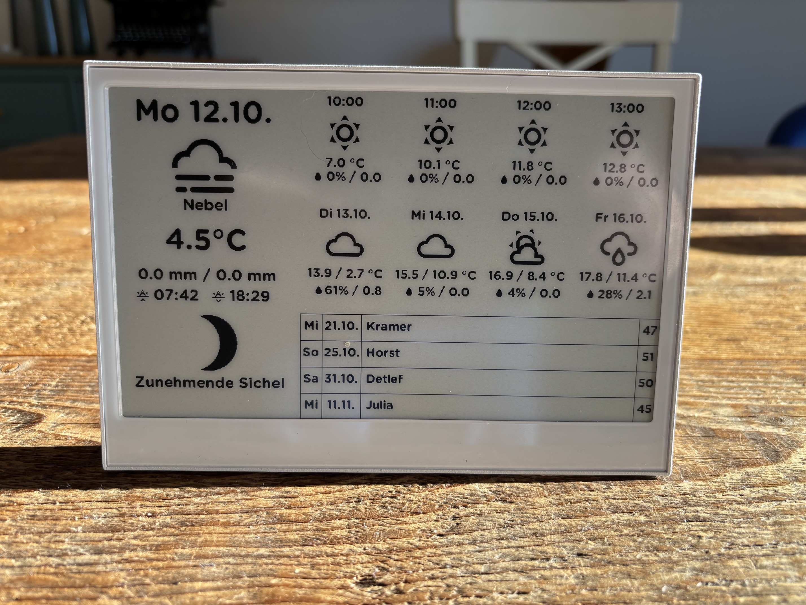

# YAHAEPD — Yet Another Home Assistant E-Paper Display

YAHAEPD is a Home Assistant-powered e-paper dashboard built with ESPHome for the **Seeed reTerminal E1001**.

The goal is to create a compact, energy-efficient display for essential household information. It combines weather data, calendar information, and astronomical details in a single, easy-to-read dashboard.

The project uses Home Assistant as the central source of data, with ESPHome handling the display, hardware interfaces, and power management.

## Display Overview

The YAHAEPD display shows current weather conditions, weather forecasts, moon phase, sunrise and sunset times, and upcoming birthdays.

## Features

- **Date and time** — Display of the current date and time.
- **Current weather** — An overview of the current weather conditions.
- **Hourly forecast** — Weather forecast for the next four hours.
- **Daily forecast** — Weather forecast for the next four days.
- **Moon phase** — Current lunar phase, including a symbol and German description.
- **Sunrise and sunset** — Local sunrise and sunset times provided by Home Assistant.
- **Moonrise and moonset** — Local moonrise and moonset times using the optional Lunar Phase integration.
- **Birthday calendar** — Birthday information supplied by Node-RED via MQTT and made available through Home Assistant sensors.
- **Battery monitoring** — Battery voltage monitoring.
- **Deep sleep** — Reduced power consumption between display updates.
- **Manual refresh** — Wake-up and display refresh using the onboard KEY0 button.

The project is under active development. Features, configuration, and documentation may change as development continues.

## Hardware

YAHAEPD is developed for the following hardware:

| Component | Specification |
|---|---|
| Device | Seeed reTerminal E1001 |
| Microcontroller | ESP32-S3 |
| Display | 7.5-inch e-paper |
| Resolution | 800 × 480 pixels |
| Display technology | Monochrome e-paper with grayscale support |

The display is controlled directly by ESPHome. Home Assistant provides the information displayed on the screen.

## Software Requirements

- [Home Assistant](https://www.home-assistant.io/)
- [ESPHome](https://esphome.io/) **2026.9.1** (version used for development and testing)
- ESPHome Arduino framework
- Seeed reTerminal E1001 with ESP32-S3
- [Node-RED](https://nodered.org/) and an MQTT broker for the birthday calendar

**Optional components**

- HACS and the [Lunar Phase integration](https://github.com/ngocjohn/lunar-phase) for moonrise and moonset times. The moon phase itself uses the built-in Home Assistant Moon integration and does not require Lunar Phase.

Other ESPHome versions may work, but the project has been developed and tested with ESPHome 2026.9.1. Compatibility with other versions has not been verified.

The required Home Assistant integrations and entities must be configured before all display features can work correctly.

## How It Works

YAHAEPD uses a simple architecture:

1. **Home Assistant** collects and prepares information, including weather forecasts, astronomical data, and precipitation values.
2. **Node-RED** retrieves birthday events from an iCal calendar and publishes the calendar data via MQTT.
3. **ESPHome** retrieves the relevant Home Assistant entity states and handles the display logic and hardware interfaces.
4. **The e-paper display** presents the information in a readable dashboard.
5. **Deep sleep** reduces power consumption between updates, while the onboard KEY0 button allows a manual wake-up and refresh.

The display is refreshed as a whole rather than by independently updating individual screen regions.

The project aims to balance useful information, readability, and energy efficiency.

## Configuration

Before using YAHAEPD, the following needs to be configured:

- Wi-Fi credentials and Home Assistant connectivity.
- The required Home Assistant integrations and entities for weather, sunrise, sunset, moon phase, and precipitation.
- The Home Assistant template sensors used to prepare forecast and display-ready values.
- Node-RED, an MQTT broker, and the required flow configuration for the birthday calendar.

Home Assistant prepares data in the required format before ESPHome receives it. For example, sunrise and sunset times are provided as local-time strings, so the display does not need to perform time zone conversion itself.

**Important:** Do not commit Wi-Fi passwords, API encryption keys, private calendar URLs, or other credentials to a public repository. Store sensitive values in an appropriate secrets configuration.

### Secrets Configuration

Copy `config/secrets.yaml.example` to `config/secrets.yaml` and replace the placeholder values with your own credentials.

The `secrets.yaml` file contains sensitive information and must not be committed to the repository. The `.gitignore` file excludes it from version control.

### Detailed Documentation

- [Home Assistant Configuration](docs/home-assistant.md) — Required integrations, template sensors, weather forecasts, sunrise and sunset, moonrise and moonset, precipitation, and display entities.
- [Node-RED Configuration](docs/node-red.md) — Birthday calendar flow, MQTT topics, MQTT Discovery, and flow installation.

### Birthday Calendar

The birthday calendar retrieves upcoming events from an iCal calendar and publishes five entries to Home Assistant via MQTT. Each entry provides the weekday, date, event name, and age, if a birth year is available.

The age field represents the age the person will turn on their birthday in the current calendar year. If the calendar event's comment contains no birth year, the corresponding age field remains empty.

The Node-RED flow processes the five entries separately to keep the logic easy to understand, debug, and customize.

The current ESPHome display configuration uses the first four rows (`A1`–`D4`). The fifth row remains available in Home Assistant but is not currently displayed.

## Project Status

YAHAEPD is a personal project in active development.

The current focus is on a reliable display layout, correct Home Assistant data handling, predictable wake-up behavior, and efficient e-paper updates.

The repository includes the ESPHome configuration, supporting files, and documentation for the Home Assistant and Node-RED components.

## License

YAHAEPD is licensed under the MIT License. See the [LICENSE](LICENSE) file for details.
