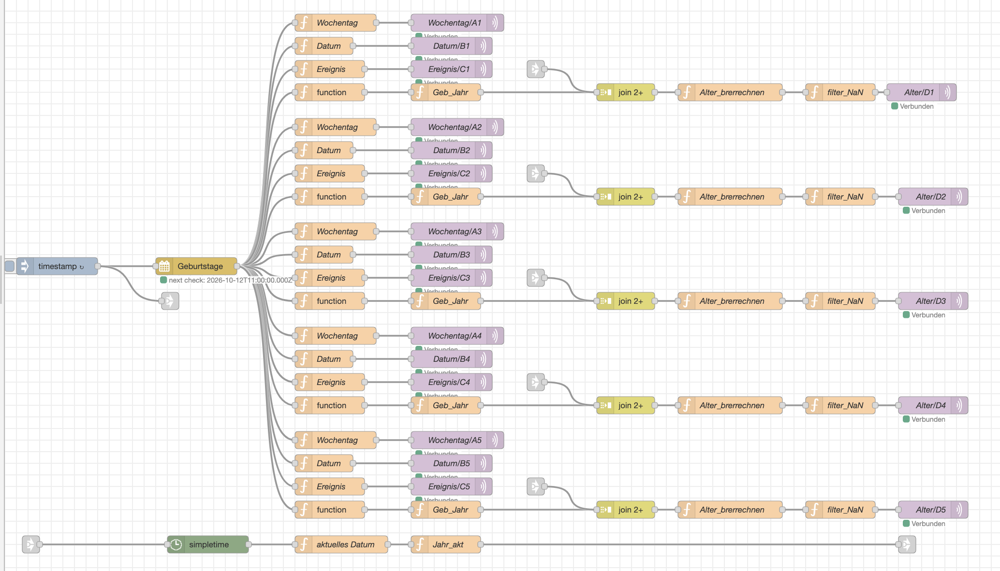
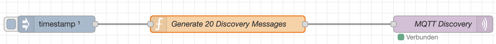

# Node-RED Configuration

YAHAEPD uses Node-RED to retrieve upcoming birthdays from an iCal calendar and publish the data to Home Assistant via MQTT. Additional flows register MQTT sensors through Home Assistant MQTT Discovery and calculate daily rainfall totals for the Plantage rain gauge using InfluxDB.

## Requirements

The following components are required for the relevant flows:

- Node-RED
- An MQTT broker accessible by Node-RED and Home Assistant
- An iCal calendar containing the birthday events
- InfluxDB 1.x for the Plantage rainfall calculation
- The following Node-RED palette modules:
  - [`node-red-contrib-ical-events`](https://flows.nodered.org/node/node-red-contrib-ical-events) — Version 2.2.5 used during development; retrieves events from an iCal calendar.
  - [`node-red-contrib-simpletime`](https://flows.nodered.org/node/node-red-contrib-simpletime) — Version 3.1.0 used during development; provides additional time and date handling nodes.
  - [`node-red-contrib-influxdb`](https://flows.nodered.org/node/node-red-contrib-influxdb) — Version 0.7.0 used by the rainfall flow to write measurements to and query InfluxDB.

Install the palette modules required by each flow before importing and deploying it. The birthday and discovery flows do not require the InfluxDB module unless you use the rainfall flow as well.

## Birthday Calendar

The birthday calendar flow retrieves upcoming events from an iCal calendar and checks for updated calendar data every three hours.

The flow processes five birthday entries and publishes the following information for each entry:

| Field | Description | MQTT topics |
|---|---|---|
| Weekday | Abbreviated weekday (`Mo`, `Di`, `Mi`, etc.) | `Display/A1`–`Display/A5` |
| Date | Date in `DD.MM.` format | `Display/B1`–`Display/B5` |
| Event | Name or summary of the event | `Display/C1`–`Display/C5` |
| Age | Age the person will turn on their birthday in the current year, if the birth year is available | `Display/D1`–`Display/D5` |

The birth year is read from the calendar event's comment. The calculated age represents the age the person will turn on their birthday in the current calendar year. If the comment is empty and contains no birth year, the corresponding age field remains empty.

### Birthday Calendar Flow

The following diagram shows the Node-RED flow used to retrieve birthday events and publish them via MQTT.

### Separate Processing of Entries

Each of the five entries is processed individually using separate Function nodes for the weekday, date, event name, and age.

This structure is intentional. It makes the flow easier to understand, debug, and customize. Although the processing could be consolidated into fewer nodes, readability and maintainability take priority over reducing the number of nodes.

### Calendar Configuration

Configure the iCal calendar in the `ical-config` node.

- **Calendar URL:** Enter the private iCal URL of your calendar.
- **Time zone:** Use `Europe/Berlin` for German local time, including automatic daylight saving time changes.
- **Preview period:** The current configuration retrieves events up to 90 days in advance.
- **Refresh interval:** The flow checks for updated calendar data every three hours.

Keep the private iCal URL confidential. It may grant access to calendar information.

### MQTT Topics

The birthday calendar flow publishes the data to the MQTT topics listed above.

The MQTT output nodes use QoS 2 and retained messages. This allows the most recently published values to remain available on the broker until they are replaced by newer values.

Configure the MQTT broker connection in Node-RED to match the broker used by Home Assistant.

## Home Assistant MQTT Discovery

The birthday discovery flow automatically registers the display sensors in Home Assistant using MQTT Discovery.

An Inject node triggers the discovery function once, two seconds after Node-RED starts. The Function node generates 20 discovery messages using nested loops:

- Rows: `1` to `5`
- Columns: `A`, `B`, `C`, and `D`
- Total: 20 sensors, from `Display A1` to `Display D5`

### MQTT Discovery Flow

The following diagram shows the Node-RED flow that registers the display sensors in Home Assistant using MQTT Discovery.

Each sensor is registered using a discovery topic in the following format:

`homeassistant/sensor/display_a1/config`

The corresponding state topic is:

`Display/A1`

The discovery payload defines the sensor name, unique ID, icon, and shared device information. All sensors are grouped under the Home Assistant device **Display Matrix**, with the model `5x4 MQTT Display` and manufacturer `NodeRed`.

Discovery messages are published with QoS 1 and retained, allowing Home Assistant to rediscover the sensors after a restart.

## Plantage Rainfall Calculation

The Plantage rainfall flow receives uplinks from The Things Stack (TTN), stores individual measurements in InfluxDB 1.x, calculates rainfall totals, and publishes the results through MQTT.

The flow export is available at [`docs/node-red/precipitation-calculation.json`](node-red/precipitation-calculation.json).

### Data Flow

The processing pipeline is:

1. **TTN uplink:** Node-RED subscribes to `v3/zeyn-regenmesser@ttn/devices/+/up`.
2. **Validation:** The flow checks the uplink payload, decoded rainfall value, frame counter, device ID, and reception timestamp.
3. **Rainfall calculation:** The raw `rainlevel` value is interpreted as a number of tipping events. Each event corresponds to `0.5 mm` of rainfall.
4. **InfluxDB storage:** The calculated rainfall and supporting fields are written to the `plantage_rain` measurement.
5. **Daily aggregation:** Every 14 minutes, Node-RED queries InfluxDB for the current and previous rainfall periods.
6. **MQTT publication:** The totals are published as retained numeric values.

### InfluxDB Measurements

The flow writes data to the `plantage_rain` measurement in InfluxDB 1.x.

| Field or tag | Description |
|---|---|
| `tip_count` | Number of tipping events reported by the device |
| `rain_mm` | Calculated rainfall amount in millimeters |
| `frame_counter` | TTN uplink frame counter |
| `device_id` tag | TTN device identifier |
| Timestamp | TTN `received_at` timestamp, converted to milliseconds |

The calculation rounds the rainfall amount to one decimal place.

The InfluxDB connection must point to the correct database and host for your installation. Configure the connection in Node-RED before deploying the flow.

### Daily Rainfall Periods

The flow calculates rainfall periods from **8:00 AM to 8:00 AM the following day**, using the `Europe/Berlin` time zone.

This approach accounts for the local time zone's daylight saving time changes when determining the boundaries of each rainfall period.

Two totals are calculated:

| Value | Period |
|---|---|
| Today | The current rainfall period, beginning at the most recent 8:00 AM boundary |
| Yesterday | The previous completed 8:00 AM–8:00 AM period |

The flow queries the `rain_mm` field and sums the values within the appropriate start and end timestamps.

The two totals are recalculated every 14 minutes. The Inject node has automatic execution on startup disabled, so the first scheduled calculation is not triggered immediately when the flow is deployed or Node-RED starts. You can manually trigger the Inject node to run the calculation sooner.

If no measurements are returned for a period, the corresponding function publishes `0 mm`. Invalid query results are logged and are not published.

### MQTT Topics

The calculated totals are published using these MQTT topics:

| MQTT topic | Description | Payload |
|---|---|---|
| `precipitation/today` | Total for the current rainfall period | Numeric rainfall total in mm |
| `precipitation/yesterday` | Total for the previous completed rainfall period | Numeric rainfall total in mm |

Both MQTT outputs publish retained messages. Subscribers can therefore receive the latest published value when they connect, even if the next scheduled calculation has not yet run.

### Home Assistant MQTT Discovery for Rainfall

The flow includes a separate discovery function for each rainfall total. Each function publishes a retained MQTT Discovery configuration message.

The discovery topics configured in the flow are:

- `homeassistant/sensor/precipitation/today/config`
- `homeassistant/sensor/precipitation_yesterday/config`

The state topics are:

- `precipitation/today`
- `precipitation/yesterday`

Both sensor definitions use millimeters (`mm`) as the unit and the precipitation device class. They share the device identifier `plantage_niederschlagsmesser` and are grouped under the device **Plantage Niederschlagsmesser**.

The discovery Inject nodes are configured for manual execution, not automatic execution on startup. After deploying the flow, trigger each discovery Inject node once to publish the configuration messages. The retained discovery messages allow Home Assistant to rediscover the sensors after a restart.

The unique IDs configured by the flow are:

- `precipitation_today_mqtt`
- `precipitation_yesterday_mqtt`

Home Assistant assigns entity IDs based on the discovery data and any existing entities. Check the entity registry if an entity already exists or if the resulting entity ID differs from your expectations.

### Troubleshooting Rainfall Calculations

- Verify that the TTN MQTT connection is active and that uplinks arrive on the configured topic.
- Confirm that the decoded payload contains a valid `rainlevel`, `f_cnt`, and `received_at` timestamp.
- Check the Node-RED logs for warnings about invalid uplinks.
- Verify that new points are being written to the `plantage_rain` measurement in InfluxDB.
- Confirm that the InfluxDB connection points to the correct database.
- Check the output of the InfluxDB query nodes and the published MQTT values.
- Verify that the MQTT broker is accessible by both Node-RED and Home Assistant.
- Manually trigger the discovery Inject nodes if the Home Assistant sensors have not been registered.
- Remember that the rainfall period changes at 8:00 AM local time, not at midnight.

## Importing and Configuring the Flows

1. Import the required Node-RED flow JSON files.
2. Install the palette modules required by each flow.
3. Configure the iCal URL in the birthday calendar configuration node.
4. Configure the TTN MQTT connection and credentials required by your installation.
5. Configure the InfluxDB connection for the rainfall flow.
6. Configure the regular MQTT broker connection used to publish the birthday and rainfall data.
7. Deploy the flows.
8. Trigger the rainfall discovery Inject nodes once.
9. Verify that the birthday and rainfall values arrive on their expected MQTT topics and that Home Assistant discovers the corresponding sensors.

The calendar processing, discovery, and rainfall calculation are separate flows and can be adapted independently. If you change MQTT topic names, update the corresponding Home Assistant and ESPHome configuration as well.

## Relationship to the ESPHome Display

The birthday calendar flow publishes five rows (`A1`–`D5`), while the current ESPHome display configuration uses only the first four rows (`A1`–`D4`).

The fifth row remains available as an MQTT sensor in Home Assistant but is not currently displayed on the e-paper screen.

The age field may be empty when the event comment does not contain a birth year. This does not prevent the weekday, date, or event name from being published.

The rainfall totals are made available through Home Assistant entities. ESPHome reads the relevant entities according to its display configuration.

## Flow Files

The repository contains the following Node-RED flow exports:

- [`birthday-calendar.json`](../node-red/birthday-calendar.json) — Retrieves upcoming birthdays from the iCal calendar and publishes weekday, date, event name, and age via MQTT.
- [`discovery.json`](../node-red/discovery.json) — Registers the 20 birthday display sensors (`Display A1` to `Display D5`) in Home Assistant using MQTT Discovery.
- [`precipitation-calculation.json`](../node-red/precipitation-calculation.json) — Stores Plantage rainfall measurements in InfluxDB, calculates today's and yesterday's totals, publishes MQTT values, and provides MQTT Discovery configurations for the rainfall sensors.

Import the required JSON files into Node-RED and configure the iCal calendar URL, TTN connection, InfluxDB connection, and MQTT broker connection before deploying the flows.

## Customization

The flows are provided as working examples. Users can adjust calendar settings, MQTT connections, discovery metadata, and rainfall processing to suit their own installations.

The five-entry birthday processing structure is deliberately kept explicit for readability. Users who prefer a more compact implementation can consolidate the repeated Function nodes themselves.
